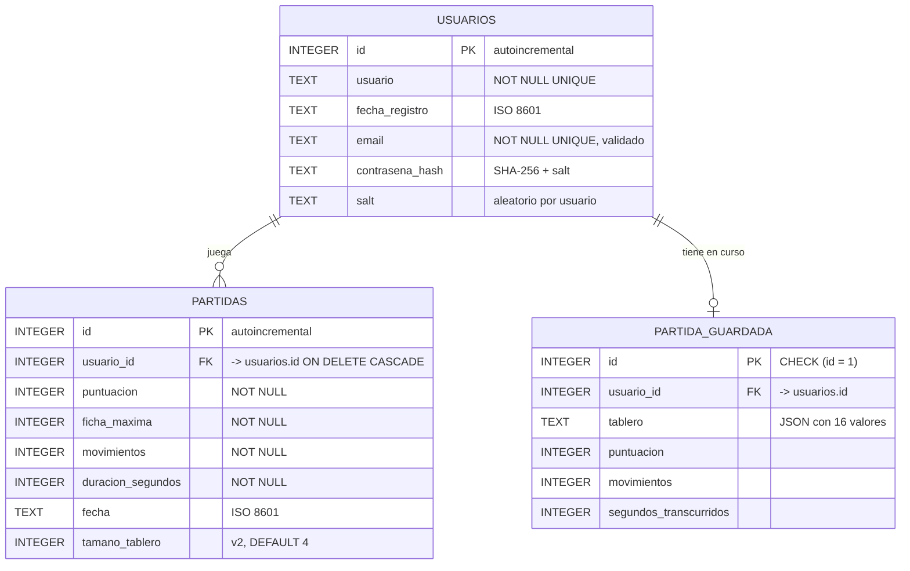
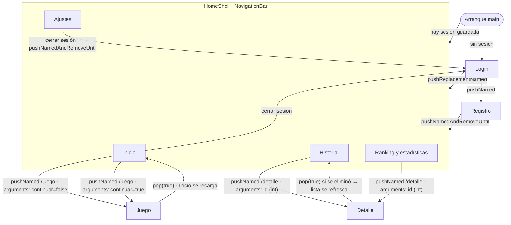

# Documentación — Capa de datos y navegación

## 1. Modelo de datos

Base de datos SQLite `game2048.db` (versión actual: **2**).



**Decisiones justificadas**

| Cambio respecto al enunciado | Motivo |
|---|---|
| `partidas.usuario` → `partidas.usuario_id` (FK) | Normalización: el nombre está una sola vez en `usuarios`. Se recupera con `INNER JOIN`. Se activa `PRAGMA foreign_keys = ON` en `onConfigure`. |
| `contraseña` → `contrasena_hash` + `salt` | Nunca se guarda la contraseña en claro. Se evita la `ñ` en el nombre de columna. |
| `usuario` y `email` `UNIQUE` | No puede haber dos cuentas iguales; el error de restricción se traduce a un mensaje para el usuario. |
| `partida_guardada.usuario_id` | La partida en curso pertenece a quien la empezó; otro usuario no la ve. |
| `CHECK (id = 1)` | Garantiza a nivel de BD que solo existe una partida en curso. |
| Índices en `usuario_id`, `puntuacion`, `fecha` | Aceleran historial, ranking y filtros. |

## 2. Arquitectura de la capa de datos

```
 Pantallas (screens/)          ← nunca contienen SQL ni usan Database
        │
        ▼
 DAOs (data/*_dao.dart)        ← todo el SQL, consultas parametrizadas
        │                         try/catch → DatosException
        ▼
 DatabaseHelper (singleton)    ← openDatabase, versión, onConfigure,
        │                         onCreate, onUpgrade
        ▼
     sqflite / SQLite

 Modelos (models/)             ← toMap() / fromMap(), sin lógica de BD
 PreferenciasService           ← único acceso a SharedPreferences
```

- **DatabaseHelper**: singleton (`DatabaseHelper.instance`). Abre la base de datos una sola vez (`_db ??= await _abrir()`).
- **UsuarioDao**: insertar (detecta `UNIQUE`), buscar por usuario o email, buscar por id.
- **PartidaDao**: CRUD del historial, filtros, ranking, estadísticas y la **transacción** `finalizarPartida`.
- **PartidaGuardadaDao**: guardar (`ConflictAlgorithm.replace`), recuperar y borrar la partida en curso.
- **Errores**: cada DAO captura `DatabaseException` y lanza `DatosException` con un mensaje legible. `AsyncDataView` lo muestra con botón de reintento.
- **Asincronía**: todas las operaciones devuelven `Future` y se usan con `async/await`.

### Consultas requeridas

| Requisito | Método | SQL clave |
|---|---|---|
| Insertar partida | `PartidaDao.insertar` | `db.insert` |
| Historial por fecha | `obtenerHistorial()` | `ORDER BY p.fecha DESC` |
| Detalle por id | `obtenerPorId(id)` | `WHERE p.id = ?` |
| Eliminar una | `eliminar(id)` | `delete ... where: 'id = ?'` |
| Eliminar todo | `eliminarTodo()` | `delete(partidas)` |
| Ranking top 10 | `obtenerTop10()` | `ORDER BY puntuacion DESC LIMIT ?` |
| Estadísticas globales | `obtenerEstadisticasGlobales()` | `COUNT, MAX, AVG, SUM` |
| Por jugador | `obtenerEstadisticasPorJugador()` | `GROUP BY p.usuario_id` |
| Filtros | `obtenerHistorial(jugador:, fichaMinima:)` | `u.usuario LIKE ?`, `p.ficha_maxima >= ?` |
| Partida en curso | `PartidaGuardadaDao.guardar/obtener/eliminar` | `id = ? AND usuario_id = ?` |

### Transacción

Al terminar una partida, `PartidaDao.finalizarPartida` hace en `db.transaction`:

1. `INSERT` en `partidas`.
2. `DELETE` de `partida_guardada`.

Si una de las dos falla, se deshace todo: nunca queda la partida registrada y a la vez guardada como "en curso".

## 3. Migración de la versión 1 a la 2

- **v1**: esquema inicial (las tres tablas).
- **v2**: nueva columna `partidas.tamano_tablero INTEGER NOT NULL DEFAULT 4`.

```dart
static const int version = 2;

Future<void> _onCreate(Database db, int version) async {
  await _crearEsquemaV1(db);
  await _onUpgrade(db, 1, version); // instalación nueva = v1 + migraciones
}

Future<void> _onUpgrade(Database db, int oldVersion, int newVersion) async {
  if (oldVersion < 2) await _migrarAV2(db);
  // if (oldVersion < 3) await _migrarAV3(db); ...
}

Future<void> _migrarAV2(Database db) => db.execute(
  'ALTER TABLE partidas ADD COLUMN tamano_tablero INTEGER NOT NULL DEFAULT 4');
```

- Un usuario que tenía la v1 instalada conserva todas sus partidas: `ALTER TABLE ... ADD COLUMN` no borra filas y las existentes reciben el valor por defecto `4`.
- Una instalación nueva ejecuta exactamente los mismos pasos, así ambos caminos llegan al mismo esquema.
- El modelo `Partida` añade `tamanoTablero` (por defecto 4) y `fromMap` tolera que la columna falte.
- La pantalla de detalle muestra el nuevo dato ("Tablero 4×4").

**Cómo probarlo**: instalar la app con la rama anterior a `julen/datos-migracion-v2`, jugar 2 partidas, actualizar a la nueva versión sin desinstalar → el historial sigue ahí y el detalle muestra "Tablero 4×4".

## 4. Preferencias (shared_preferences)

| Clave (constante) | Tipo | Uso |
|---|---|---|
| `claveModoTema` | String (`ThemeMode.name`) | Claro / oscuro / sistema. Por defecto `system`. |
| `clavePaletaFichas` | String | Paleta de colores de las fichas. |
| `claveUltimoJugador` | String | Precarga el login (ampliación B.3). |
| `claveMejorPuntuacion` | int | Mejor puntuación mostrada al instante en Inicio (B.3). |
| `claveVibracion` | bool | Vibración al fusionar (B.3). |
| `claveSesionUsuarioId` | int | Mantener la sesión abierta. |

Las preferencias se leen en `main()` tras `WidgetsFlutterBinding.ensureInitialized()` y **antes de `runApp`**, así que el primer frame ya usa el tema correcto. `TemaController` (`ChangeNotifier`) notifica a `MaterialApp`, que se reconstruye con `theme`, `darkTheme` y `themeMode` en tiempo real.

## 5. Diagrama de navegación



- **Rutas centralizadas** en `lib/routes.dart` (`AppRoutes.generar` con `onGenerateRoute`). Es el único archivo que crea `MaterialPageRoute`.
- **Paso de datos**: el historial pasa solo el `id`; `DetalleScreen` consulta la BD con `obtenerPorId`.
- **Devolución de resultados**: `Navigator.pop(context, true)` al eliminar; el historial hace `await pushNamed<bool>` y recarga si recibe `true`.
- **PopScope en Juego**: con partida en curso pregunta *Guardar y salir / Salir sin guardar / Cancelar*.
- **Arranque**: Inicio consulta `PartidaGuardadaDao.obtener(usuarioId)`; si existe, muestra "Continuar partida", que abre `/juego` con `continuar = true`, y el juego carga el estado desde la BD.
- **Fin de partida**: diálogo con *Jugar de nuevo* / *Volver al inicio* tras la transacción.
